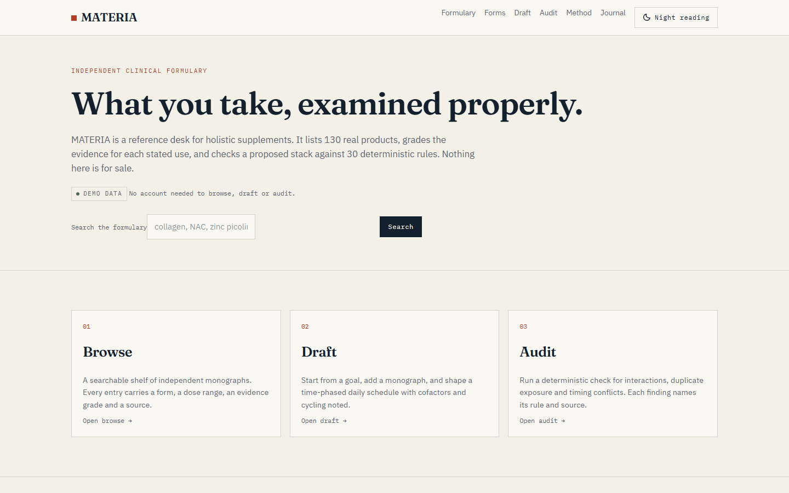
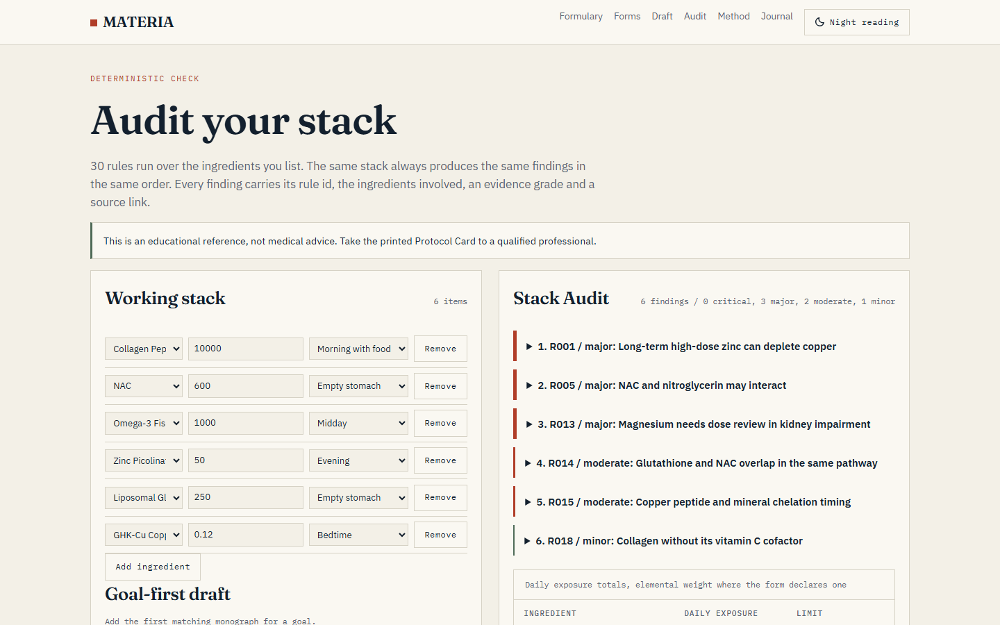
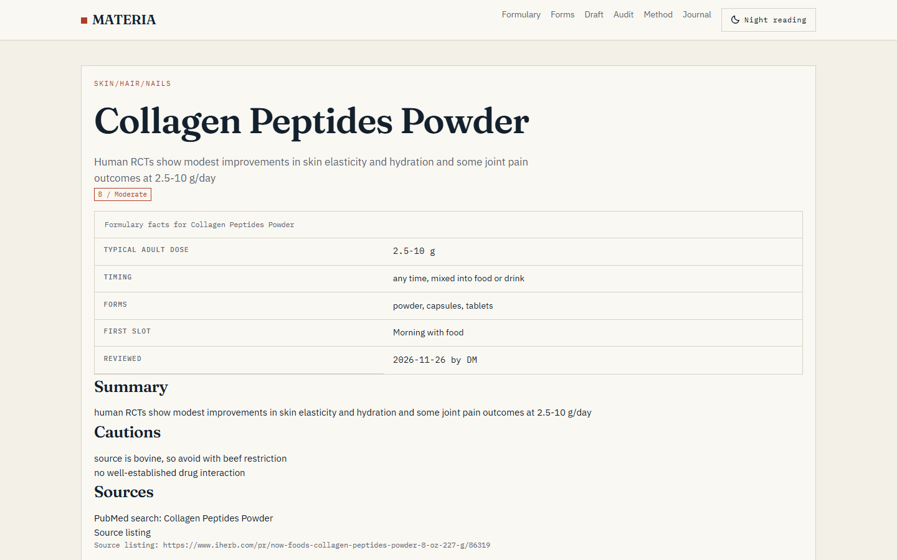

# MATERIA

An independent evidence-graded formulary for holistic supplements, with a deterministic stack audit and a printable Protocol Card.

[](https://materia-formulary.vercel.app)
[](https://github.com/devtechedge/materia-formulary/actions/workflows/ci.yml)
[](https://nextjs.org/)
[](https://www.typescriptlang.org/)
[](LICENSE)

---

## Live Demo

**https://materia-formulary.vercel.app**

> **Status:** Public demo data from a checked snapshot dated 26 November 2026. The 134 monographs and 30 rules are static; no account or database is required. Nothing is fetched at runtime. Production runs on Node 22 in region bom1. Web analytics and Speed Insights are off on this Hobby project. The app is educational reference only and does not diagnose or prescribe. Vercel Hobby allows 100 deployments per day; git pushes share that limit.

---

## Screenshots

| Formulary desk | Stack audit |
|----------------|-------------|
|  |  |

| Monograph |
|-----------|
|  |

---

## Features

- Browse 134 real monographs with category filters and an A to D evidence grade on every row.
- Compare forms: zinc picolinate versus zinc oxide, liposomal glutathione versus NAC, triglyceride fish oil versus flax oil, and four more pairs.
- Audit a stack with 30 deterministic rules. Every finding carries severity, evidence grade, citation and a suggested action. The same stack always produces the same output.
- Sum elemental exposure across a stack and flag stated upper limits.
- Compile a time-phased Protocol Card with cofactors and cycling notes, then export Markdown or print one page.
- Keep an optional outcome journal in local browser state. Those scores never leave the tab.
- Self-hosted Fraunces, IBM Plex Sans and IBM Plex Mono. Day and night reading themes.

---

## Tech Stack

| Layer | Technology |
|-------|------------|
| Frontend | Next.js 16 App Router, React 19, Tailwind CSS 4 |
| Language | Strict TypeScript 5.9, Zod 4 |
| Data | Drizzle ORM with Neon Postgres path; deterministic demo dataset on Vercel |
| Tests | Vitest, Playwright with axe |
| Hosting | Vercel, team devtechedge1 |
| CI | GitHub Actions on Node 22 |

---

## Quick Start

```bash
npm install
npm run dev
```

Open http://localhost:3000.

Checks:

```bash
npm run lint
npm run typecheck
npm run test
npm run test:e2e
npm run build
```

The dataset is generated from checked catalog research and the three fonts are self-hosted. Regeneration steps are documented in the repository.

---

## License

MIT. See [LICENSE](LICENSE).
